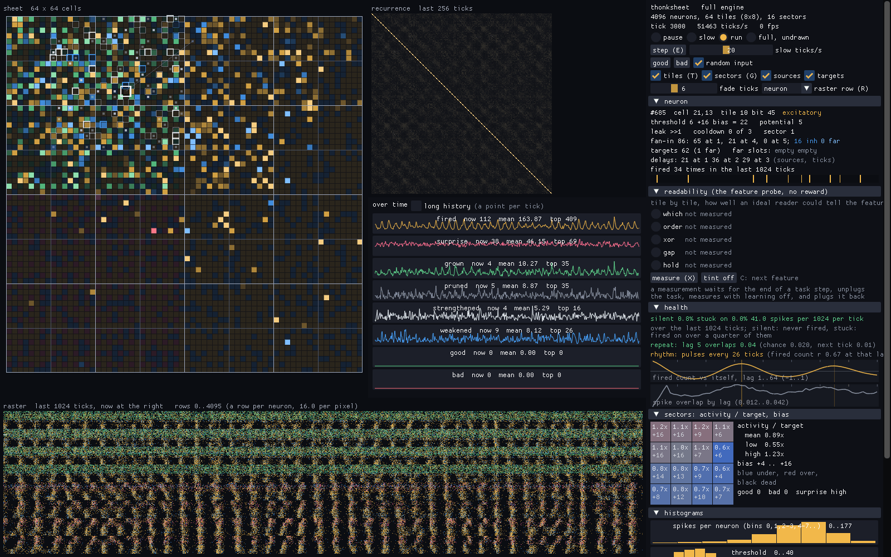
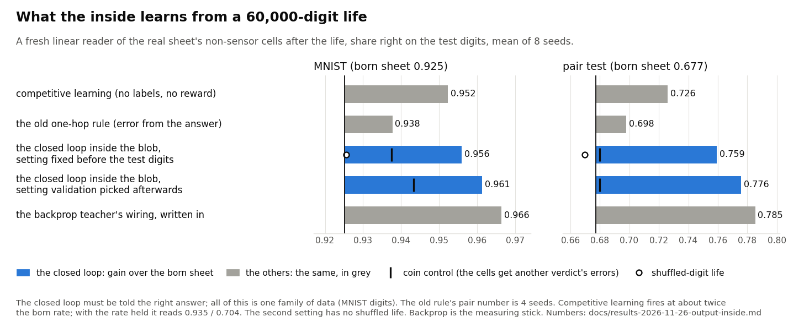
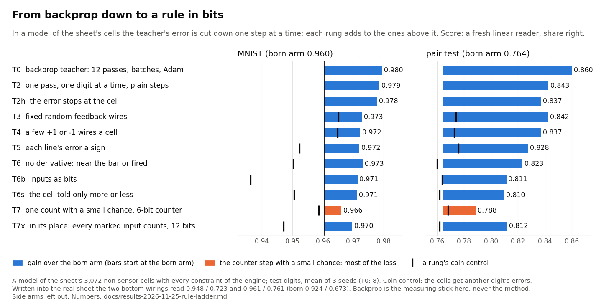
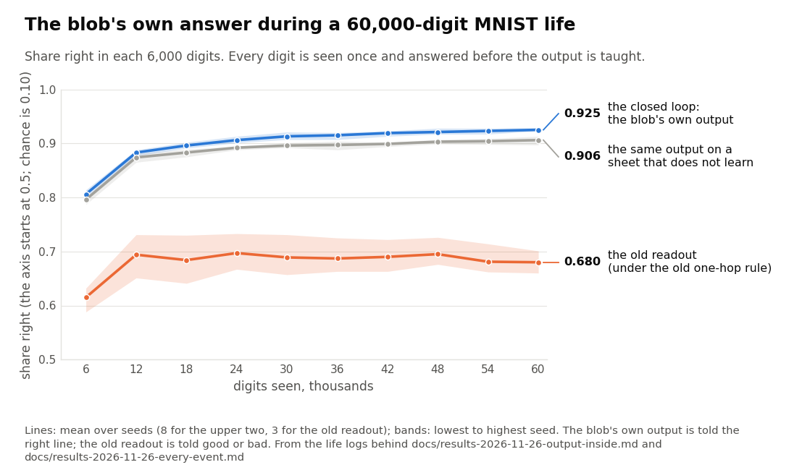
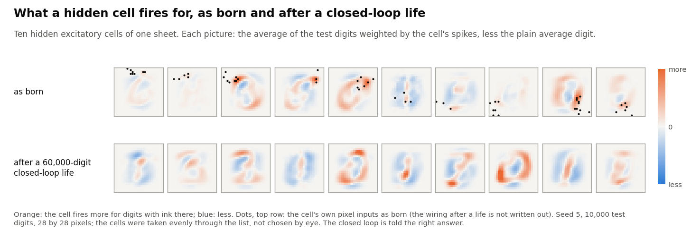
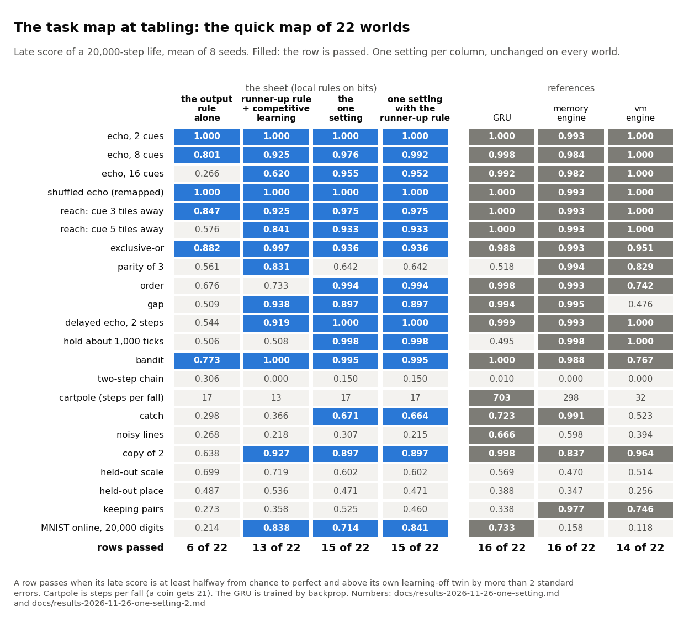
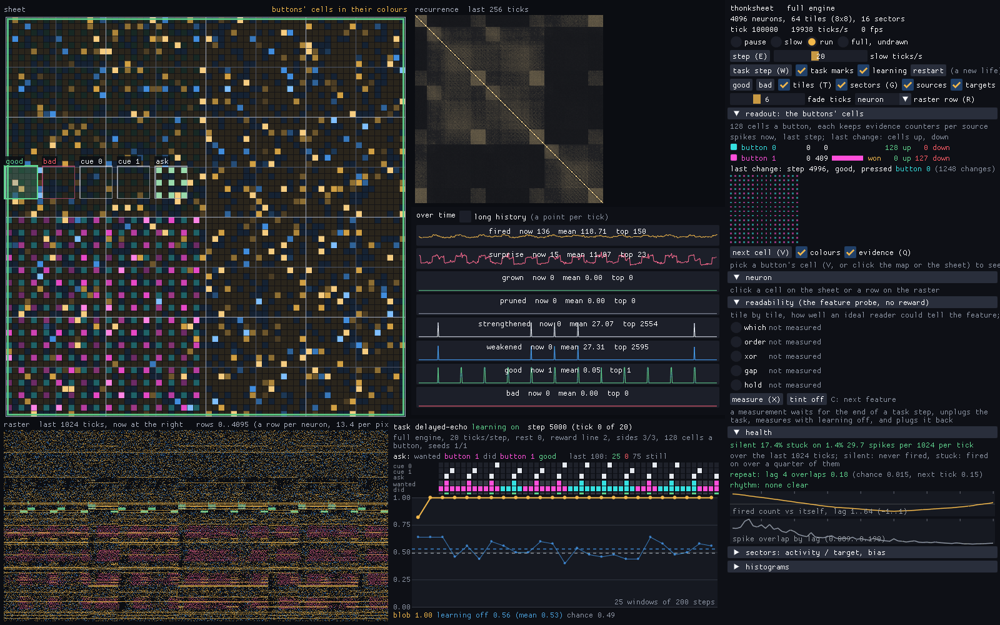
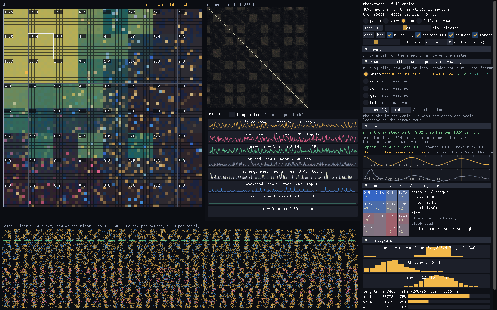

# thonksheet

A brain made of bits that never stops ticking. Binary spiking neurons on a tiled sheet, wired
locally, learning by local rules with no backprop, laid out to suit an ordinary CPU and GPU.
A research notebook as much as a codebase: every result, null and wrong guess is in `docs/`.

**Tabled 2026-11-26.** Nothing is running. This page says what it is, what it found, what it
did not, and where to start if it is picked up again.



## What it is

- A sheet of 4,096 neurons (64 tiles of 64, one tile a 64-bit word). Each neuron listens to
  its own tile, its eight neighbours and two far tiles, with 2-bit weights kept as bit planes.
  A tick is ANDs and popcounts. `docs/design.md` has every mechanism and how it is laid out
  for the machine; `docs/diagram.html` is the same as a picture.
- A world writes bits onto sensor cells and reads the output. The worlds are small tasks
  (echo, exclusive-or, delays, bandits, catch, cartpole, MNIST and more), defined in
  `docs/curriculum.md` and grouped in `docs/task-map.md`.
- The goal was to find rules that make such a machine learn any task, online, without
  backprop. Backprop is used here only as a measuring stick.

## What it found

The question the work narrowed to: **can local rules make the inside of the sheet learn
features**, not only its output. The test: after a life, freeze the sheet, fit a fresh
reader on its hidden cells, and compare with the sheet as born and with controls.

The answer is yes, on one family of data, with the right answer told:



Three pieces made it work. Each was found by walking from backprop down to our rule one cut
at a time and seeing where it broke (`docs/results-2026-11-25-rule-ladder.md`):



1. **The error sent one hop.** Each output line's error reaches each hidden cell on a fixed
   random wire, as a sign. No backward pass, no derivative, no multiply.
2. **Count every event.** A cell steps a 12-bit counter on every input that was on. Stepping
   a 6-bit counter by a small chance, as the first version did, is what lost the features.
3. **One line up, one line down.** Told the right answer, the output moves only the right
   line and the closest wrong one, and tells the cells only those two
   (`docs/results-2026-11-26-output-inside.md`).

With all three inside the blob, its own answer on MNIST goes from 0.68 right to 0.925:





The settings: `--g.out_on 1 --g.out_top 1 --g.hop_on 1 --g.hop_bits 12 --g.hop_shift 0
--g.hop_teach 6`. The table and its controls: `scripts/outputinside.sh report`.

## What it is not

- In the literature's words the working rule is random-feedback learning with sign-only
  errors and integer counters, plus a perceptron with a margin, on one layer of features.
  That is known science in a cheap form, not a new principle.
- It needs the right answer told. A good-or-bad-only version was started and teaches the
  cells on MNIST on two seeds; cartpole and catch still fail.
- It has been shown on MNIST, pairs of MNIST digits and, in part, Kuzushiji-MNIST.
- The rules that organise themselves with no error (competitive learning, learned loops,
  six label-free families) gave little or nothing.
- Never reached: features of features, learned memory past about two steps, prediction as
  the only teacher inside the blob, and the cut-down to the smallest machine that keeps the
  result. A plain GRU trained by backprop still passes more of the task map:



`docs/findings.md` starts with "Where it stopped" and then holds every result with its
evidence and its grade. `docs/plan.md` starts with "If this is picked up again".

## The viewer

`scripts/view.sh` opens the sheet live; `scripts/watch.sh` opens it on a task. Keys and
panels are in `docs/notes-viewer.md`. Single frames without a window: `scripts/captures.sh`.





## Build and run

```
scripts/build.sh                      build everything into build/
scripts/refcheck.sh                   four reference lives must print "same"
scripts/bench.sh                      tick speed
scripts/task.sh                       one blob on one task, score to CSV
scripts/get_mnist.sh                  the MNIST files into data/mnist
scripts/outputinside.sh report        the closed loop's table (long: 8 seeds)
scripts/outputinside.sh smoke --quick the same line of work, short
scripts/oneset.sh best                one setting on the 22-world quick map
scripts/scoreboard.sh                 docs/scoreboard.md from out/scorecards/
scripts/figures.py                    the plots in docs/img/ (`cells` runs two lives)
```

Every experiment has a script named after it in `scripts/` with its recipe in the header,
and a dated write-up `docs/results-*.md` that quotes the exact lines. Needs CMake, a C++20
compiler, SDL3 and Vulkan for the viewer, python3 with matplotlib for the plots, and torch
only for the measuring-stick models (`scripts/ladder2.sh` and after).

## Where things are

- `AGENTS.md`: the rules for working here
- `docs/design.md`: the mechanisms and how each is laid out for the machine
- `docs/findings.md`: what we think we know, with the evidence
- `docs/ideas.md`: every idea tried or waiting, numbered 1 to 189, with its outcome
- `docs/predictions.md`: what was predicted before each job, scored after
- `docs/plan.md`: the queue as it stood, and where to start again
- `docs/task-map.md`, `docs/curriculum.md`, `docs/scoreboard.md`: the tasks and the scores
- `docs/notes-world.md`, `docs/notes-viewer.md`: every probe, flag and key
- `docs/img/README.md`: each picture and the line that remakes it
- `src/blob`: the engine; `src/minimal`, `src/table`, `src/memory`, `src/vm` and the
  reference nets in `src/nn` sit behind the same shell; `src/world`: the tasks; `src/run`:
  the headless runner; `src/view`: the viewer; `src/probe`, `src/mnist`: the measuring
  tools; `src/gpu`: many blobs ticked at once on the GPU
